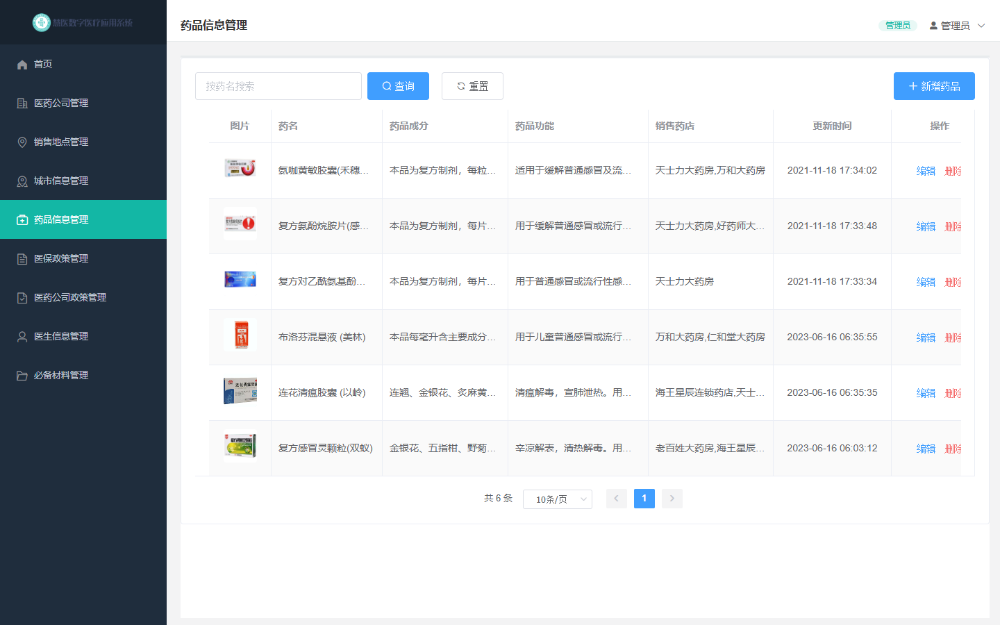
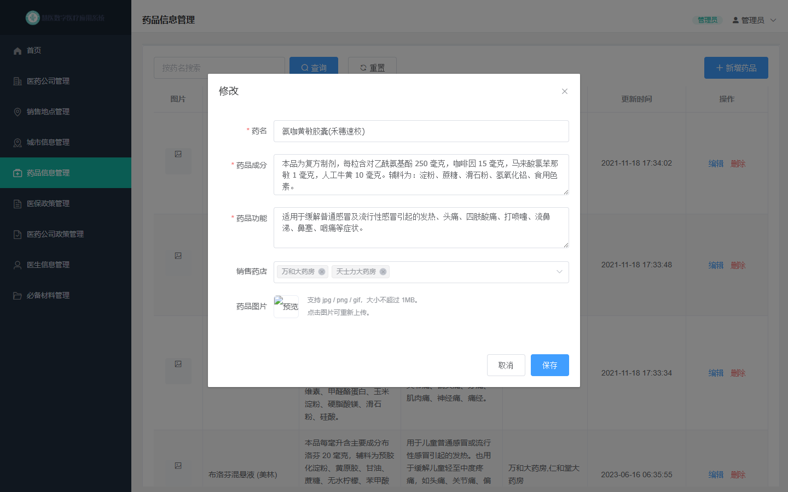
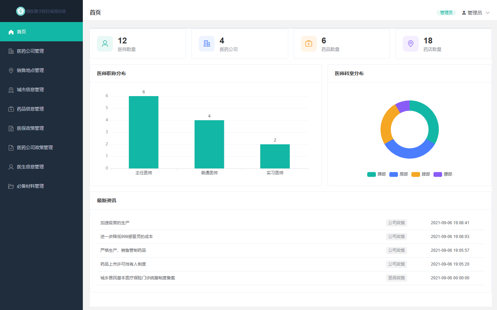
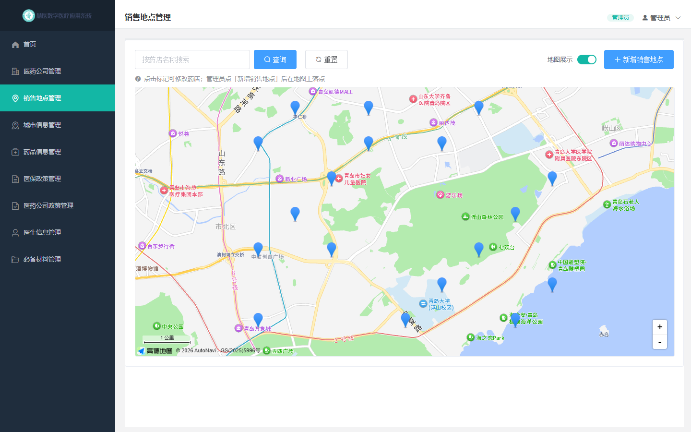
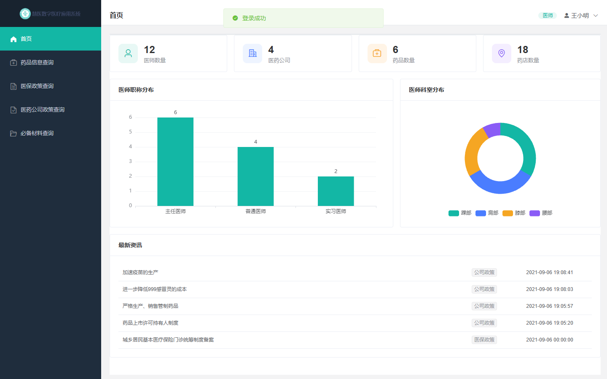

# 6. 用户界面设计

## 6.1 界面清单与关系

| 序号 | 界面名称 | 界面标识（路由） | 功能说明 | 可见角色 |
| --- | --- | --- | --- | --- |
| 1 | 登录 | `#/user/login` | 用户名口令登录，含演示账号提示 | 全部 |
| 2 | 首页数据面板 | `#/home` | 四个统计数字、职称柱状图、科室饼图、最新资讯 | 管理员、医师 |
| 3 | 医药公司管理 | `#/base/company` | 公司列表、搜索、增改删 | 管理员（医师无入口） |
| 4 | 销售地点管理 | `#/base/sale` | 列表/地图切换、增改删、地图选点 | 管理员（医师无入口） |
| 5 | 城市信息管理 | `#/base/city` | 城市列表、搜索、新增、删除 | 管理员（医师无入口） |
| 6 | 药品信息管理 | `#/manage/drug` | 列表、搜索、增改删、图片上传、关联药店 | 管理员（全功能）、医师（查询+新增） |
| 7 | 医保政策管理 | `#/manage/medical/policy` | 政策列表、增改删、按城市生效 | 管理员、医师（查询） |
| 8 | 医药公司政策管理 | `#/manage/company/policy` | 政策列表、增改删、挂靠公司 | 管理员、医师（查询） |
| 9 | 医生信息管理 | `#/manage/doctor` | 医师列表、增改删、重置口令 | 管理员（医师无入口） |
| 10 | 必备材料管理 | `#/manage/material` | 材料列表、增改删 | 管理员、医师（查询） |
| 11 | 404 | `#/*` | 未匹配路由兜底 | 全部 |

界面关系：**登录页 → 动态菜单 → 各业务模块**。菜单项不是写死的，而是登录后由后端 `/api/permissions` 按角色下发，前端 `routeParse` 把菜单树翻译成路由并 `addRoute`。因此管理员看到 9 个入口、医师只看到 5 个，同一套前端代码，两套菜单。

## 6.2 界面原型

### 6.2.1 登录页

设计说明：背景使用素材提供的医疗主题图（青绿主色 + 白色弧形留白），表单卡片居中偏下压在白色区域；演示账号直接印在卡片底部，答辩时不用另外翻文档。

### 6.2.2 管理员首页与菜单

设计说明：左侧深色侧栏 240px，选中项用青绿高亮；顶部显示当前页面标题、角色标签与用户下拉（退出登录）；内容区浅灰底、白色卡片。

### 6.2.3 药品管理页

设计说明：表格第一列是图片缩略图（点击可放大预览），销售药店列由后端 `GROUP_CONCAT` 一次带出，避免二次请求；更新时间统一 `yyyy-MM-dd HH:mm:ss`，不再折行。

### 6.2.4 药品编辑弹窗（含上传与关联药店）

设计说明：关联药店是多选下拉，编辑时回填该药品已有的 `saleIds`；图片区域点击即可重新上传，上传成功后立即显示预览。

### 6.2.5 首页数据面板

设计说明：四个统计卡片用不同色系的图标区分；职称用柱状图（对比数量）、科室用环形饼图（看占比）；资讯列表带来源标签，三种内容表合并展示。

### 6.2.6 销售地点地图

设计说明：列表页顶部一个「地图展示」开关，打开后把表格换成高德地图，18 个药店标记铺在青岛市区；管理员点「新增销售地点」进入选点模式，在地图上点一下就落点，并自动逆地理编码出街道地址。

### 6.2.7 医师视角（权限差异）

设计说明：同一套前端，医师登录后菜单只剩 5 项，标题从「XX管理」变成「XX查询」；药品页的「编辑/删除」按钮不渲染，但真正的拦截在后端。

## 6.3 交互一致性约定

| 场景 | 统一做法 |
| --- | --- |
| 列表页结构 | 顶部搜索栏（关键字 + 查询 + 重置 + 新增）→ 表格 → 右下分页 |
| 新增/修改 | 统一用弹窗（`el-dialog`），表单必填项标红并带校验提示 |
| 删除 | 必须先弹二次确认，确认文案包含记录名称 |
| 操作反馈 | 成功用绿色消息条，失败用红色并显示后端返回的 `mess` |
| 加载状态 | 表格与地图用 `v-loading`，提交按钮用 `:loading` 防重复点击 |
| 空数据 | 表格空态与「暂无资讯」等文案统一灰色小字 |
